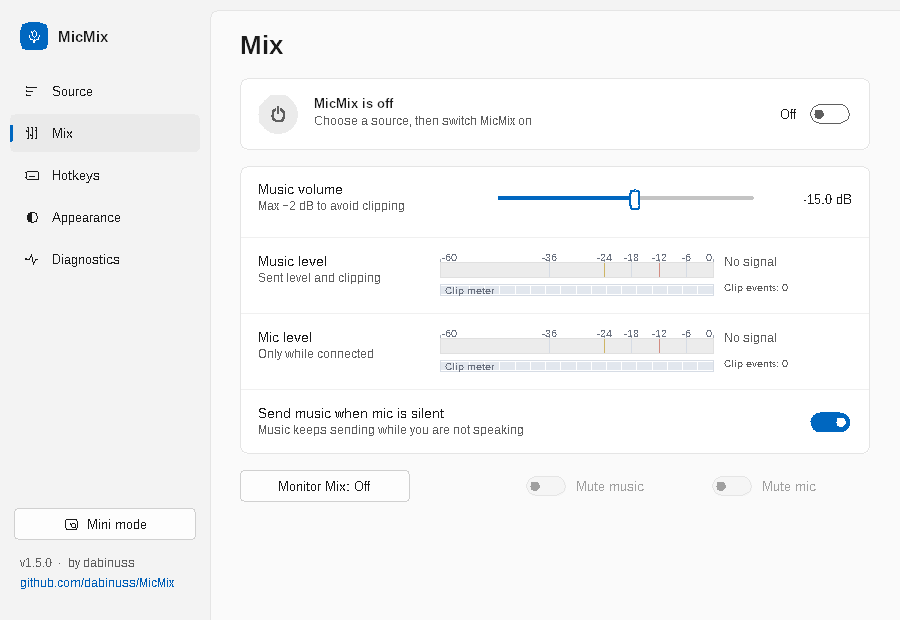
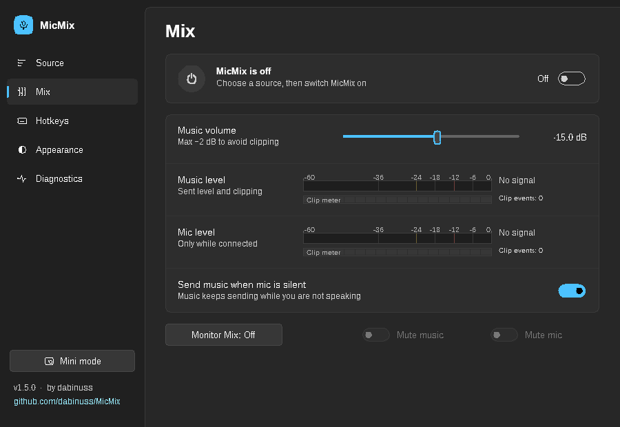
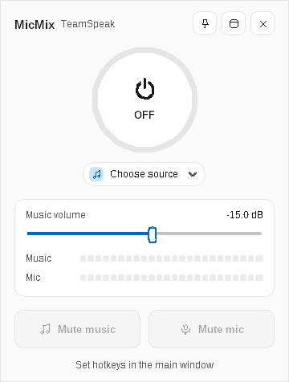
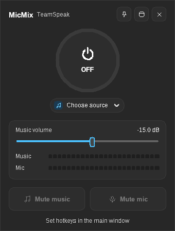
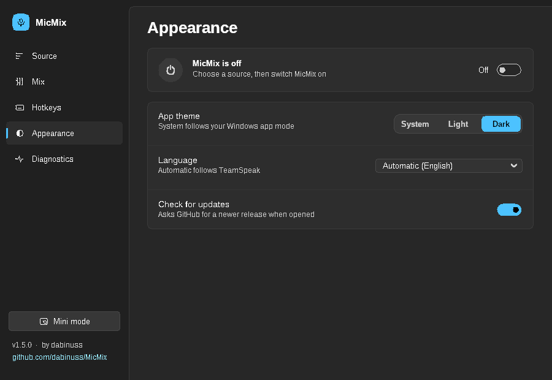

# MicMix


MicMix is a Windows plugin for TeamSpeak 3 that mixes a second audio source (music, browser audio, media player
audio, etc.) into your microphone stream. Talk and play audio in the same channel, without virtual cable chains.

**[⬇ Download the latest release](https://github.com/DatMayo/MicMix/releases/latest)** (`MicMix-x.y.z-win64.ts3_plugin`)

This is a fork of [dabinuss/MicMix](https://github.com/dabinuss/MicMix) with a redesigned settings window, mini
mode, dark mode, translations, an update notice and automated builds and releases.

## Important Disclaimer

**This project was developed with help from Codex, an AI coding agent by OpenAI.**
AI-assisted development can introduce mistakes, edge-case bugs, or unintended behavior. Use MicMix with caution,
especially in production-like or critical setups.

The full source code is public. **Please review the code**, verify behavior, and report bugs, regressions, or
security concerns.

## Screenshots

| Light | Dark |
| --- | --- |
|  |  |

| Mini mode | Appearance |
| --- | --- |
|   |  |

## Features

**Audio**

- Mix your microphone and one audio source into your TeamSpeak voice transmission.
- Capture either a whole output device (`Loopback`) or a single running app (`App Session`, e.g. Spotify, a
  browser, VLC).
- Music volume slider (capped at −2 dB to reduce clipping) and live level meters with clip indicators for music
  and microphone.
- Mute music and microphone separately, by button or global hotkey.
- Keep sending music while you are not talking.
- Listen to the mixed signal yourself (`Monitor Mix`) while connected.
- Start automatically with TeamSpeak and reconnect the source after errors.
- Publish `micmix_active=<0|1>` in the client metadata for server tools ([details](#server-operator-tag-micmix_active)).

**Settings window**

- Windows 11 style window with five pages: Source, Mix, Hotkeys, Appearance, Diagnostics.
- Status card on every page showing what MicMix is doing, with a master On/Off switch.
- **Mini mode:** a compact window with power button, source, volume, meters and mute buttons. It can stay on
  top, and reopens where you left it.
- **Dark mode:** follows Windows or set to light/dark, including a dark title bar.
- **12 languages:** follows your TeamSpeak language automatically.
- Sharp on high-DPI screens; adapts when moved between monitors with different scaling.
- **Update notice** when a newer release is available.

## Requirements

- Windows 10 or Windows 11, 64-bit.
- TeamSpeak 3 Client `3.6.2` (plugin API `26`).
- Headphones are recommended to avoid echo.

## Quick Start

1. [Download](https://github.com/DatMayo/MicMix/releases/latest) the `.ts3_plugin` file and double-click it,
   then confirm the installation in TeamSpeak.
2. In TeamSpeak, enable `MicMix` under *Tools → Options → Addons* (or *Plugins*).
3. Open *Plugins → MicMix → MicMix Settings…*.
4. On the **Source** page, choose the audio source (an output device or a running app) and check the microphone.
5. Turn MicMix on with the switch in the status card.
6. On the **Mix** page, set the music volume and watch the meters. Test the levels in a channel with a friend.
7. Optional: turn on *Send music when mic is silent* so music continues while you are not talking.

## Using MicMix

### Pages

| Page | What you set there |
| --- | --- |
| **Source** | Audio source, microphone, start with TeamSpeak, restart the source after device changes |
| **Mix** | Music volume, music and mic level meters, send music when silent, monitor mix, mute buttons |
| **Hotkeys** | Global hotkeys to mute music and to mute the microphone input |
| **Appearance** | Theme (System / Light / Dark), language, update check |
| **Diagnostics** | Live technical status (buffer underruns, clipping, resampler, levels) |

### Mini mode

Click **Mini mode** at the bottom of the sidebar. The compact window shows a large power button, the current
source (click it to go back to the Source page), music volume, meters and mute buttons.

- **Pin** keeps it above other windows.
- **Expand** returns to the full window.
- Drag it anywhere by an empty area.

If you close MicMix while in mini mode, it reopens in mini mode at the same position.

### Theme and language

- **Theme:** `System` (default) follows *Windows Settings → Personalization → Colors → Choose your app mode* and
  switches live. `Light` and `Dark` force a theme.
- **Language:** English, German, French, Spanish, Italian, Portuguese, Dutch, Polish, Russian, Turkish, Czech and
  Chinese. `Automatic` (default) uses your TeamSpeak 3 client language (read from its `settings.db`), then the
  Windows display language, then English. Choosing a language switches the UI immediately.

### Update notice

The first time the settings window opens in a TeamSpeak session, MicMix asks GitHub in the background for the
latest release of this repository
(`https://api.github.com/repos/DatMayo/MicMix/releases/latest`). If it is newer than your version, the sidebar
shows **Update x.y.z available**, which opens the release page.

- Nothing is downloaded or installed automatically.
- Only the plugin version is sent (`User-Agent: MicMix/<version>`).
- Turn it off with **Check for updates** on the Appearance page.

### Configuration file

Settings are saved automatically to `config.ini` in the TeamSpeak config folder, next to the MicMix log:

```text
%APPDATA%\TS3Client\plugins\micmix\config.ini
%APPDATA%\TS3Client\plugins\micmix\micmix.log
```

UI-related keys (all set from the settings window):

| Key | Values | Default |
| --- | --- | --- |
| `ui.theme` | `system`, `light`, `dark` | `system` |
| `ui.language` | `auto`, `en`, `de`, `fr`, `es`, `it`, `pt`, `nl`, `pl`, `ru`, `tr`, `cs`, `zh` | `auto` |
| `ui.update_check` | `true`, `false` | `true` |
| `ui.last_open_tab` | page index `0`–`4` | `0` |
| `ui.mini.enabled` | reopen in mini mode | `false` |
| `ui.mini.pinned` | mini window stays on top | `false` |
| `ui.mini.x`, `ui.mini.y` | last mini window position | unset |

## Typical Use Cases

- DJ in TeamSpeak: play music for your channel while still talking normally.
- Roleplay or gaming immersion: use it as an in-car radio replacement on RP servers.
- Community events: stream intro music, ambience, or short jingles.
- Watch parties: share browser or media app audio while coordinating by voice.

## How It Works

MicMix hooks into TeamSpeak's captured-voice callback and edits outgoing voice frames before they are sent.

- TeamSpeak plugin API `26`.
- Windows audio capture via WASAPI (loopback or per-process app capture).
- Internal mix target at `48 kHz` mono.
- Lock-free ring buffer between the capture thread and the voice callback.
- Resampling with `speexdsp` when the source sample rate differs.
- Source state handling with start, stop, running and automatic reacquire after errors.
- Settings UI in plain Win32 with GDI+ drawing, per-monitor DPI aware.

## Server Operator Tag (`micmix_active`)

MicMix writes a runtime marker into TeamSpeak client metadata:

- `micmix_active=1`: MicMix currently detects active music signal being sent.
- `micmix_active=0`: no current active music signal.

Implementation details:

- The value is written to `CLIENT_META_DATA` and merged into existing metadata as a `;`-separated key-value pair.
- Existing metadata tokens are kept, only the `micmix_active` token is updated/replaced.
- Updates are throttled to avoid metadata spam, so there can be short delay on state transitions.

How server operators can use it:

1. Read `client_meta_data` via ServerQuery or a bot.
2. Parse for token `micmix_active=1`.
3. Use it as a signal for UI/badges, logging, moderation hints, or music-bot/channel automation.

```text
if "micmix_active=1" in client_meta_data:
    mark_client_as_music_source()
else:
    clear_music_source_marker()
```

Important: this tag is client-published metadata and should be treated as a helpful signal, not a hard security
control.

## Development

### Prerequisites

- Windows with Visual Studio 2022 or newer, or the matching Build Tools (workload *Desktop development with C++*).
- CMake `>= 3.21` (the copy bundled with Visual Studio is detected automatically).
- Git.

The TeamSpeak 3 Plugin SDK and SpeexDSP are fetched automatically into `third_party/` at pinned commits.

### Build

Double-click `build.cmd`, or run from PowerShell:

```powershell
.\scripts\build.ps1
```

This checks the prerequisites, fetches dependencies, picks the CMake generator matching your Visual Studio,
builds Release, runs the unit tests and creates `dist/MicMix-<version>-win64.ts3_plugin`.

| Option | Effect |
| --- | --- |
| `-Configuration Debug` | Debug build (no package) |
| `-Clean` | Delete `build/` before configuring |
| `-SkipTests` | Skip building and running the unit tests |
| `-NoPackage` | Do not create the `.ts3_plugin` |
| `-Version 1.6.0` | Override the version from `VERSION` |
| `-Install` | Copy the plugin into `%APPDATA%\TS3Client\plugins` (close TeamSpeak first) |
| `-Generator "..."` | Use a specific CMake generator |

<details>
<summary>Manual build</summary>

```powershell
cmake -S . -B build -G "Visual Studio 18 2026" -A x64   # or "Visual Studio 17 2022"
cmake --build build --config Release
ctest --test-dir build -C Release --output-on-failure
.\scripts\package_ts3_plugin.ps1 -Configuration Release
```

CMake options: `MICMIX_VERSION_OVERRIDE` (version string), `MICMIX_BUILD_TESTS` (`ON`/`OFF`),
`MICMIX_UPDATE_REPO` (repository checked for updates, default `DatMayo/MicMix`).

</details>

### Project layout

| Path | Contents |
| --- | --- |
| `src/plugin_main.cpp` | TeamSpeak plugin entry points |
| `src/micmix_core.*` | Audio capture, mixing, config store, hotkeys |
| `src/settings_window.cpp` | Settings window: pages, settings logic, DPI, language, update notice |
| `src/settings_ui.h` | Shared declarations of the settings UI |
| `src/ui_theme.cpp`, `src/ui_draw.cpp`, `src/ui_controls.cpp` | Theme, drawing primitives, owner-drawn controls |
| `src/mini_window.cpp` | Mini mode window |
| `src/i18n.*` | Translations and language detection (one row per text in `i18n.cpp`) |
| `src/update_check.*` | GitHub release check |
| `tests/` | Unit tests (`ctest`) |
| `scripts/` | Build, packaging and release scripts |

### CI

Every push and pull request is built and tested on Windows by GitHub Actions. Each run attaches the built
`.ts3_plugin` as an artifact (*Actions → run → Artifacts*, kept 14 days), so changes can be tried in TeamSpeak
before merging.

### Releasing

Releases are cut from the commits since the last `vX.Y.Z` tag. The version follows
[`VERSIONING.md`](./VERSIONING.md) and Conventional Commits: a breaking change bumps MAJOR, any `feat` bumps
MINOR, everything else bumps PATCH.

- **From GitHub (recommended):** *Actions → Release → Run workflow*, choose `auto` (or `patch` / `minor` /
  `major`). The workflow updates `VERSION`, `CMakeLists.txt` and `CHANGELOG.md`, commits
  `chore(release): vX.Y.Z`, tags it, builds and tests the plugin and publishes the GitHub release with the
  `.ts3_plugin` and its SHA256.
- **Locally:**

  ```powershell
  .\scripts\release.ps1 -DryRun   # show next version and release notes
  .\scripts\release.ps1 -Push     # build, commit, tag and push; GitHub publishes the release
  ```

Notes under `## [Unreleased]` in [`CHANGELOG.md`](./CHANGELOG.md) become the release notes. Without them, notes
are generated from the commit subjects (Added / Fixed / Changed).

## Credits

- Original MicMix by [dabinuss](https://github.com/dabinuss/MicMix).
- Third-party components: see [`THIRD_PARTY_NOTICES.md`](./THIRD_PARTY_NOTICES.md).
- Architecture notes and roadmap: [`DEVPLAN.md`](./DEVPLAN.md).
